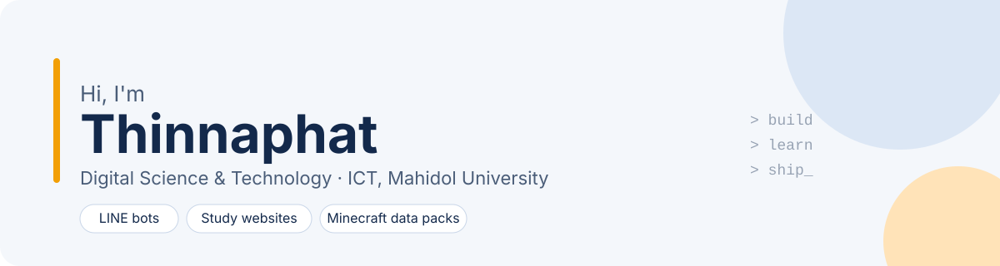
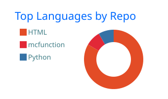
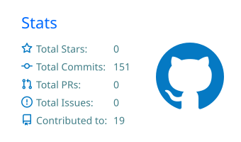

<picture>
  <source media="(prefers-color-scheme: dark)" srcset="assets/hero-dark.svg">
  
</picture>

### About me

- 🎓 2nd-year student, **Digital Science & Technology (DST)**, Faculty of ICT, Mahidol University
- 🌐 Most at home with **networking**; getting better at web development one project at a time
- 🛠️ I build small tools that solve real problems: for my family, my classmates, and my Minecraft world

### Featured projects

<table>
  <tr>
    <td width="50%" valign="top">
      <h4>📮 <a href="https://github.com/Thinnaphat-tht/laan-chuay-aan-showcase">Laan Chuay Aan</a></h4>
      A LINE bot that helps elderly people read Thai official letters. Send a photo, get a plain-language summary, deadlines and amounts due, plus a warning if it looks like a scam.
        
      
      
      
      
    </td>
    <td width="50%" valign="top">
      <h4>⛏️ <a href="https://github.com/Thinnaphat-tht/Trading-Cooldown-Notification">Trading Cooldown Notification</a></h4>
      A Minecraft data pack that shows a live countdown above villagers whose trades have sold out, read from vanilla's own restock mechanics. No mods required.
        
      
      
      
    </td>
  </tr>
</table>

### Study websites

Free exam-prep sites I made for my ICT courses. Each one runs in the browser, no sign-up.

| Course | Topic | Site |
|---|---|---|
| ITDS211 | Computer Architecture: summary, 270 practice questions, cheatsheet | [Open](https://thinnaphat-tht.github.io/ITDS211-Computer-Architecture/) |
| ITDS231 | Interactive ARQ simulator (Stop-and-Wait, Go-Back-N, Selective Repeat) | [Open](https://thinnaphat-tht.github.io/arq-lab/) |
| ITDS231 | Computer Networks glossary, Lectures 1–7 | [Open](https://thinnaphat-tht.github.io/itds231-glossary/) |
| ITDS241 | JavaScript notes, practice quiz, mock exam | [Open](https://thinnaphat-tht.github.io/Quiz-JavaScript/) |
| ITDS241 | Node.js summary + 230 practice questions | [Open](https://thinnaphat-tht.github.io/ITDS241-NodeJS-Quiz/ITDS241-NodeJS-Summary-Quiz.html) |
| ITDS261 | Software Engineering midterm practice quiz | [Open](https://thinnaphat-tht.github.io/ITDS261-Midterm-Quiz/) |
| ITDS261 | Quiz 2 guide: DFD, error detection, Git, unit testing | [Open](https://thinnaphat-tht.github.io/ITDS261-Quiz2-Guide/) |

### Tools I use

  
  
  
  
  
  
  
  
  
  

### GitHub stats

  
  

  

<picture>
  <source media="(prefers-color-scheme: dark)" srcset="https://raw.githubusercontent.com/Thinnaphat-tht/Thinnaphat-tht/output/snake-dark.svg">
  
</picture>
