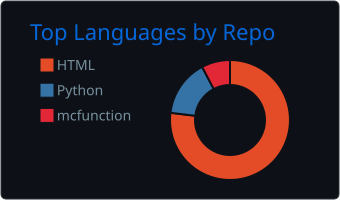
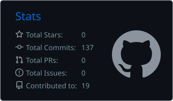

  
  

| Course | What's inside | |
|---|---|---|
| `ITDS211` | Computer Architecture: summary, 270 practice questions, cheatsheet | [▶ Play](https://thinnaphat-tht.github.io/ITDS211-Computer-Architecture/) |
| `ITDS231` | Interactive ARQ simulator: Stop-and-Wait, Go-Back-N, Selective Repeat | [▶ Play](https://thinnaphat-tht.github.io/arq-lab/) |
| `ITDS231` | Computer Networks glossary, Lectures 1–7 | [▶ Play](https://thinnaphat-tht.github.io/itds231-glossary/) |
| `ITDS241` | JavaScript notes, practice quiz, mock exam | [▶ Play](https://thinnaphat-tht.github.io/Quiz-JavaScript/) |
| `ITDS241` | Node.js summary + 230 practice questions | [▶ Play](https://thinnaphat-tht.github.io/ITDS241-NodeJS-Quiz/ITDS241-NodeJS-Summary-Quiz.html) |
| `ITDS261` | Software Engineering midterm practice quiz | [▶ Play](https://thinnaphat-tht.github.io/ITDS261-Midterm-Quiz/) |
| `ITDS261` | Quiz 2 guide: DFD, error detection, Git, unit testing | [▶ Play](https://thinnaphat-tht.github.io/ITDS261-Quiz2-Guide/) |

  

  
  

  
  

  

